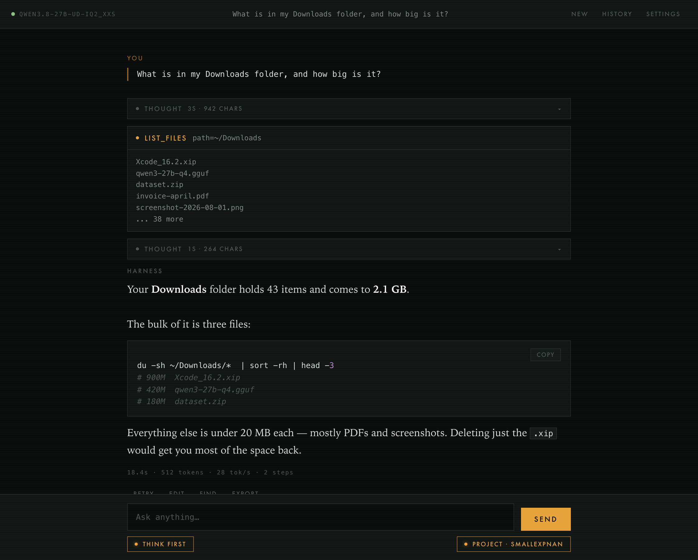
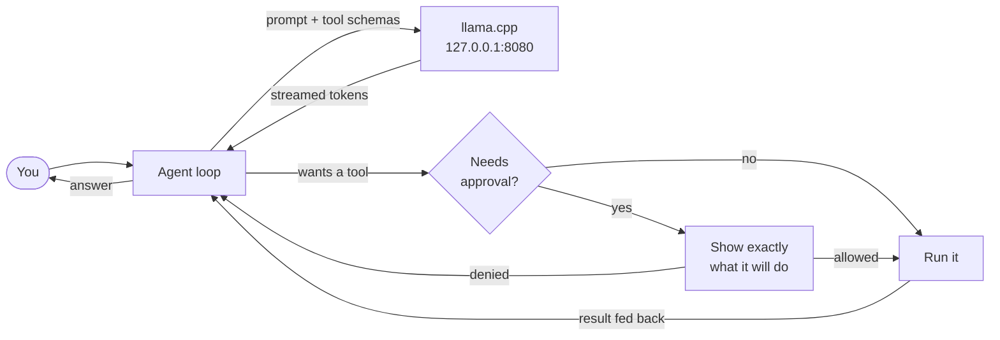
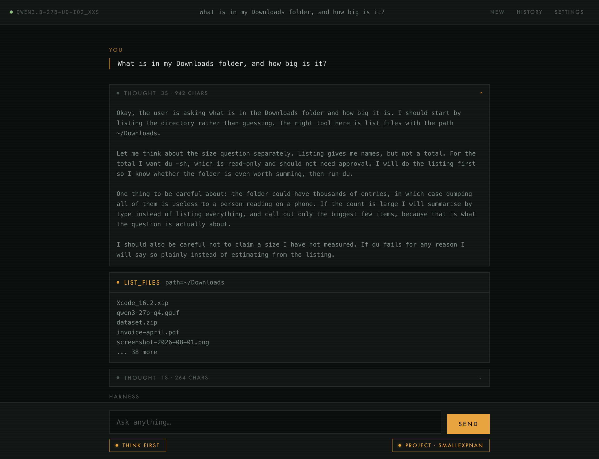
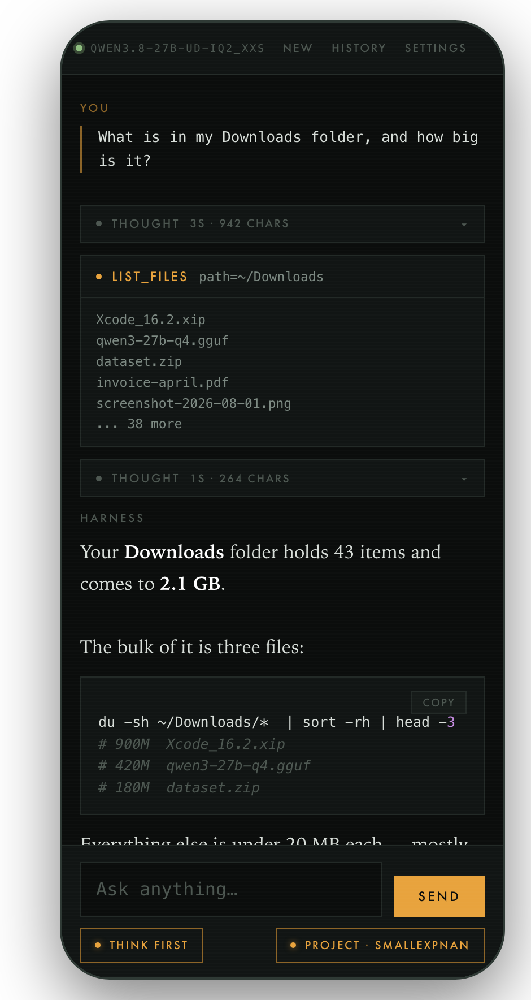

# Harness

**A local AI assistant that can actually do things.** It reads and writes files,
runs commands and searches the web — on your own Mac, with a model that never
leaves it. Nothing you type is sent to anyone.

[](https://github.com/DavidCvetkovski/harness/actions/workflows/tests.yml)
[](LICENSE)
[](https://www.python.org/)
[](requirements.txt)



Everything above happened on one laptop. llama.cpp serves a quantised model over
Metal; a small agent loop reads what it writes, notices when it asked for a tool,
runs the tool, and hands the result back. That loop is the whole difference
between a chatbot and an assistant.

## Start it

```bash
bin/harness              # this Mac only
bin/harness --lan        # also on your local Wi-Fi
bin/harness --remote     # from anywhere, over Tailscale
```

Then open <http://127.0.0.1:8420>. Turn on auto-start in the System tab and you
never need to run this again.

Other commands: `stop`, `status`, `restart`, `chat` (terminal instead of the
browser), `model` (model server only), `deps` (install the optional extras).

## How it works



Three decisions shape the whole thing:

**There is one agent loop, not one per front end.** Where its output goes is a
`Sink` — the terminal prints, the web server queues events for the browser, a
scheduled run throws them away. `harness chat` and the browser therefore run
identical code, and a fix lands in both at once.

**Everything streams.** Generation runs at a couple of tokens a second on a
quantised 27B. Held back until complete, that reads as a hang; streamed, it
reads as typing. The same applies to the parts that aren't the answer — the
model's reasoning, the bytes of a file being written, the seconds a tool has
been running. Anything that makes you wait says what it is waiting for.

**Approval is a preview, not a prompt.** Before a file is written you see the
path, whether it exists, how big it is now and the first lines of what would
replace it. Before a command runs you see the command. The question is never
"do you trust this?" but "is this what you meant?"

### What the model is thinking



Reasoning is streamed into a panel of its own. It stays in the transcript
afterwards, collapsed to a line, so you can go back and read why it did what it
did — which is usually more interesting than the answer.

## Safety

Seven tools: list files, read, write, edit, search the web, fetch a page, run a
shell command. The rules around them:

| Rule | Why |
|---|---|
| Writing or editing asks first, showing the exact change | The preview is the only thing between the model and your file |
| `/System`, `/usr`, `/etc`, `/Library`, `~/.ssh`, `~/.zshrc` and friends are refused outright | Breaking these breaks the machine, not your work — no approval can authorise it |
| Anything chained — pipes, `;`, `&&`, backticks — always asks | The first word of a pipeline tells you nothing about the rest of it |
| Reading `~/.ssh`, `~/.gnupg`, `~/.aws`, `~/.harness` always asks, whatever the settings say | Tool output is kept verbatim in the session file, so a key read once is a key on disk |
| Scheduled runs have the write tools switched off | Nobody is awake at 3am to approve anything, and a bare refusal just makes the model try again |

Approvals can be relaxed per-category — trust your project folder, or only ask
about destructive commands — but the refusals above are not settings.

## From your phone



| Mode | Reachable from | Token needed |
|---|---|---|
| default | this Mac | no |
| `--lan` | your Wi-Fi network | yes |
| `--remote` | anywhere, via Tailscale | no — Tailscale already authenticated the device |

`--remote` binds only the Tailscale address, so the socket does not exist on
your local network or the public internet. Add it to your home screen from the
browser's share menu and it opens without the Safari chrome.

## Tests

```bash
python3 -m unittest discover -s tests -t .
```

109 tests, no test framework to install — the suite is standard library, like
the rest of the project. Most of them are about the guards: what a protected
path is, which commands stop and ask, that a refusal really does leave the disk
alone, and that one client cancelling a turn cannot silently refuse an approval
another client is looking at.

They redirect `harness.config`'s paths to a temporary directory first, so
running the suite on the machine Harness is installed on cannot disturb a real
session, automation or token.

## Layout

```
bin/harness          entry point — sets PYTHONPATH and runs harness.cli
harness/
  cli.py             start / stop / status
  server.py          HTTP routes, streaming, approvals, admin actions
  agent.py           the loop: stream, call a tool, feed the result back
  tools.py           the seven tools, and the guards around them
  config.py          settings, presets, automations, access token
  ui.html            the whole front end, one file
  model.sh           llama.cpp launcher
tests/               the guards, the loop, sessions, scheduling, concurrency
```

State lives in `~/.harness/` — sessions, settings, automations, access token,
logs. Models live in `~/llm/models/`.

## Requirements

- macOS on Apple silicon
- llama.cpp built with Metal at `~/llm/llama.cpp`
- A GGUF model in `~/llm/models/`
- Python 3.9+ — and nothing else, to run or to test
- Optional: `ddgs` for web search, `qrcode` for the phone QR (`bin/harness deps`)
- Optional: Tailscale, for `--remote`

## Notes

Sessions are stored in plain text and include whatever the tools returned —
file contents, command output, fetched pages. Treat `~/.harness/sessions/` the
way you would treat a shell history file.

Web pages and command output are untrusted input. The model reads whatever a
page says, so treat its conclusions with the same suspicion you would treat the
page itself.

## License

MIT — see [LICENSE](LICENSE).
